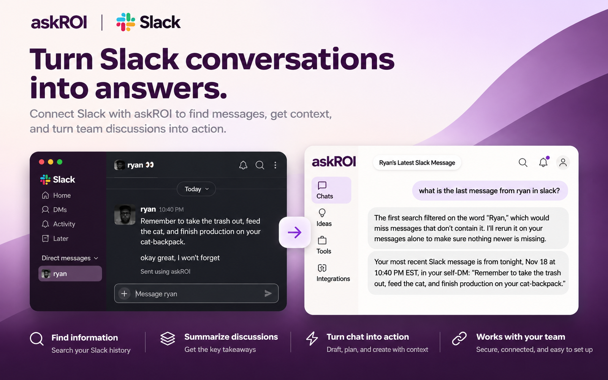

Connect your Slack workspace to askROI to ask questions about conversations you can access. You can find past decisions, catch up on threads, and draft replies or team updates using context from Slack.

## Install and set up the Slack app

1. Select **Add to Slack** above. You can also start in askROI by opening **Tools**, selecting **Integrations**, choosing **Add** next to **Slack**, and selecting **Connect**.
2. In Slack, choose the workspace you want to connect and review the requested permissions.
3. Select **Allow** to authorize askROI. Wait for askROI to show **Connected**.
4. Open a chat in askROI and ask it to find a message or summarize a Slack thread.

## Watch the installation walkthrough

Follow the setup from **Integrations** in askROI through Slack’s authorization screen to the **Connected** confirmation.

<video
  controls
  playsInline
  preload="metadata"
  className="w-full aspect-video rounded-xl"
  aria-label="Slack installation and authorization walkthrough"
  src="/videos/slack-installation.mp4"
>
  Use the link below to open the video in your browser.
</video>

[Open the installation video directly](/videos/slack-installation.mp4)

## What you can do with Slack in askROI

- **Find messages and decisions.** Ask “What did we decide about pricing in Slack last week?”
- **Catch up on a discussion.** Ask “Summarize the launch discussion in #product and list the action items.”
- **Draft replies and updates.** Ask “Draft a short project update for my team channel based on the latest Slack discussion.”
